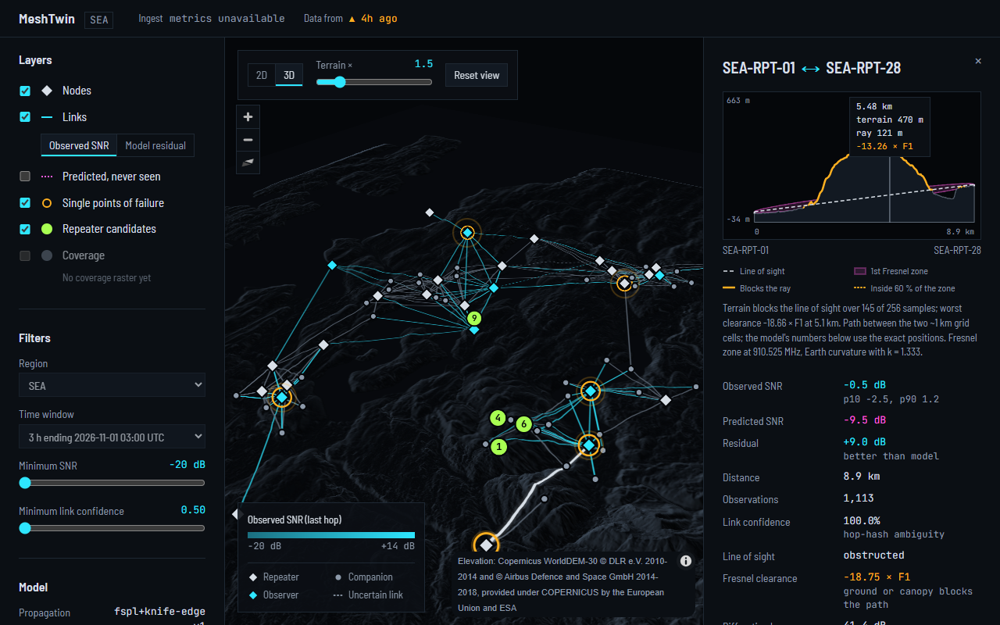

# MeshTwin

A coverage digital twin for live [MeshCore](https://github.com/meshcore-dev/MeshCore) LoRa mesh networks.
It listens to observer nodes, works out which radios can actually hear each other, compares that with what
terrain says *should* happen, finds the repeaters the network can't afford to lose, and suggests where the
next one would help most.


```
observer nodes ──MQTT──▶ Go ingester ──Parquet──▶ S3 (SeaweedFS) ──▶ Python analytics (CronJobs)
                         decode, buffer,            region=/date=/hour=     topology · terrain propagation
                         spool to disk when S3 is down                     resilience · placement
                                                                                 │ JSON summaries
                                                                                 ▼
                                    browser ◀── 3D console ◀── Go read-only API (grid-snapped locations)
                         Prometheus + Grafana watch all of it; everything runs on k3d via one Helm chart
```

| | |
|---|---|
| **Go** | `ingest/`: MQTT/replay/synthetic sources, packet decoder (fuzzed), Parquet writer, DDIL disk spool. `api/`: read-only REST API that also serves the console |
| **Web** | `web/`: Vite + React + TypeScript console on MapLibre GL: 3D terrain, link inspector with terrain profile and Fresnel zone, node what-if, live ingest status. Works offline |
| **Python** | `analytics/`: DuckDB over Parquet, probabilistic hop resolution, networkx resilience, FSPL + knife-edge terrain model on Copernicus GLO-30, placement search |
| **Kubernetes** | `deploy/helm/meshtwin`: ingester, API, SeaweedFS, CronJobs, Prometheus, Grafana, NetworkPolicy, restricted pod security on every pod |
| **CI** | `.github/workflows/ci.yml`: gofmt, vet, race tests, golangci-lint, govulncheck, ruff, mypy --strict, pytest, web build + self-checks, Playwright smoke tests, helm lint, image builds, Trivy, Syft SBOMs, k3d smoke test |

## Run it

Needs Docker, [k3d](https://k3d.io) and Helm. Recipes are POSIX sh (Linux, WSL or Git Bash).

```sh
make cluster images smoke   # local cluster, end to end on the synthetic TEST fixture (~5 min after the first image build)
# console: http://127.0.0.1:8090/
# Grafana: http://127.0.0.1:3030/  user admin, password:
#   kubectl --context k3d-meshtwin -n meshtwin get secret meshtwin-grafana -o jsonpath='{.data.admin-password}' | base64 -d
make chaos                  # DDIL demo: break storage and the ingester, prove zero loss (~25 min)
make deploy                 # real settings, no test data
make clean
```

Real data comes from one of two settings (`deploy/compose/`, how-to in [docs/recording.md](docs/recording.md)):
1. **own observer**: your MeshCore observer publishes to the bundled broker. QoS 1, persistent session.
2. **public broker**: a community broker, with credentials the operator gives you. QoS 0, rate-limited, subscribe only.

Synthetic data exists for tests, CI and the smoke/chaos demos only, and is labelled as such everywhere.

Console development (`web/`, details in [docs/frontend.md](docs/frontend.md)): `make web` builds and self-checks it,
`make e2e` runs the Playwright smoke tests against the real API.

## What it does

**Topology.** MeshCore floods record each relay as a 1–3 byte prefix of its public key. Prefixes collide (a 1-byte hash has
256 values), so a hop is never treated as an identity. A forward-backward pass over each path, with a distance prior, gives
every inferred link a confidence. On the 1-byte test fixture: link precision 0.994, every single point of failure found.

**Predicted vs observed.** Free-space path loss plus knife-edge diffraction over a 30 m elevation model, compared with the SNR
observers measured on the last hop. The map colours each link by how much better or worse it is than the model.

**Resilience.** Removes each relay in turn and counts the node pairs that can no longer reach each other, relay-aware
(companions don't forward floods).

**Placement.** Scores every 0.01° cell for the reachability it would add and the single points of failure it would remove.

**Console.** One 3D map tells the story: the real terrain (the same Copernicus elevation data the model uses), what the
model predicted, what the mesh actually did, and where the next repeater should go. Clicking a link shows the ground
between its two ends, the line of sight and the first Fresnel zone, with obstructions marked.



**DDIL.** When object storage is down, the ingester spools Parquet files to a persistent volume (fsync, content-addressed) and
drains them newest-first when it returns, optionally rate-capped for a thin link. `make chaos` cuts storage, flaps it, kills the
ingester mid-outage and caps the drain, then checks every reception arrived: 4,337/4,337, no duplicates.

## Privacy

Node locations are often people's homes. So:
- **Metadata only.** Payloads are never decrypted and never stored.
- **Every location that leaves analytics is a ~1 km grid cell** (0.01°). The API validates this on every response and refuses
  anything finer; tests in both lanes prove raw coordinates never appear.
- Node ids are 8-hex key prefixes; names are shown only for repeaters and room servers, never for personal devices.
- Broker connections are subscribe-only, region-filtered, rate-limited and identifiable. Each source and its terms are in
  [docs/data-sources.md](docs/data-sources.md).

## Docs

| | |
|---|---|
| [docs/plan.md](docs/plan.md) | the eight phases, decisions and follow-ups |
| [docs/protocol.md](docs/protocol.md) | MeshCore wire format and observer feed, cited to source; open items marked UNVERIFIED |
| [schema/](schema/) | the Parquet schema (Go ↔ Python contract) |
| [docs/api-contract.md](docs/api-contract.md) | the JSON contract (analytics ↔ API) |
| [docs/frontend.md](docs/frontend.md) | the console: decisions per phase, how to run and test it |
| [analytics/README.md](analytics/README.md) | the algorithms in plain words |
| [docs/benchmarks.md](docs/benchmarks.md) | every measured number, with how to reproduce it |
| [docs/data-sources.md](docs/data-sources.md) | data sources, their terms, pinned images |
| [docs/ai-workflow.md](docs/ai-workflow.md) | how the AI-assisted build is organised: lanes, an independent verifier, hooks |
| [docs/interview-prep.md](docs/interview-prep.md) | the design decisions as questions, with short answers |

## Limits, honestly

- **No real capture yet.** Every accuracy number is on synthetic data. The model is deliberately not tuned to it.
- The terrain model uses a surface model (tree and roof tops), so it over-predicts blockage in forested areas.
- A hard kill of the ingester loses rows still in memory; QoS 0 (public broker) loses messages while it is down.
- The synthetic generator ignores terrain, so on the demo data the model-vs-reality view shows the model fitting the
  generator, not the world ([docs/frontend.md](docs/frontend.md), "Reading the SEA demo data honestly").
- The console's street/water basemap is an optional one-time download (`web/scripts/fetch-basemap.sh`); without it the
  map shows hillshaded terrain only.

## Attribution

Basemap (when installed) © OpenStreetMap contributors, Protomaps. Terrain: produced using Copernicus WorldDEM-30 © DLR e.V. 2010-2014 and © Airbus
Defence and Space GmbH 2014-2018 provided under COPERNICUS by the European Union and ESA; all rights reserved. The
organisations in charge of the Copernicus programme by law or by delegation do not incur any liability for any use of the
Copernicus WorldDEM-30.
